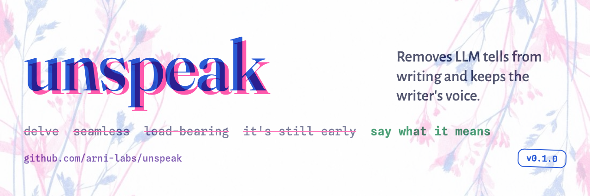

# unspeak



A writing skill for coding agents to remove LLM tells and keep the writer's voice. Works with any harness that reads SKILL.md (Claude Code, Codex, Cursor, and others).

## Use

- `/unspeak` rewrites the draft in front of you. Add words to direct it: `/unspeak this file`, `/unspeak write about ...`.
- `/unspeak-init` builds your voice reference: paste a few pieces of your writing, the agent files them.
- `/unspeak-add word, phrase, "bad snippet"` files new offenders into the lists.
- `python3 unspeak/proofread.py draft.md` checks a file without an agent.

## Examples

A technical post and a personal blog. The left column is a draft an agent wrote with no skill; the right is another agent given only "unspeak this draft" with the skill installed.

<table>
<tr><th>Draft</th><th>unspeak</th></tr>
<tr><td><strong>The dashboard was slow because of a date function</strong><br><br>Our ops dashboard has a panel called &quot;Orders by region, last 30 days.&quot; It took 11 seconds to load. Everything else on the page came back in under 200ms.<br><br>The query behind it was unremarkable:<br><br><code>SELECT region, count(*), sum(total_cents) FROM orders WHERE date_trunc(&#x27;day&#x27;, created_at) &gt;= now() - interval &#x27;30 days&#x27; GROUP BY region;</code><br><br>`EXPLAIN ANALYZE` showed a sequential scan over all 48 million rows, 10.9 seconds of it. There was an index on `created_at`, and it was being ignored.<br><br>The reason is the `date_trunc` call. Postgres indexes the column value, not the result of a function applied to it. Wrapping `created_at` in `date_trunc` makes the predicate unsargable — the planner cannot use the index to satisfy it, so it reads the whole table and evaluates the function 48 million times.<br><br>The `date_trunc` was not doing anything anyway. The comparison is against a timestamp 30 days back; truncating each row to midnight only changes which rows near the boundary are included, and nobody had ever relied on that. Removing it:<br><br><code>WHERE created_at &gt;= now() - interval &#x27;30 days&#x27;</code><br><br>Same query plan shape, different access path: index scan on `orders_created_at_idx`, 340ms. A 32x improvement from deleting seven characters.<br><br>Two things I took away. First, when an index exists and the planner refuses to use it, look at what is wrapped around the column before looking at anything else — functions, casts, and `COALESCE` all have this effect. Second, this query had been slow since the panel shipped 14 months earlier. It was never slow enough to page anyone and it never appeared in the slow query log, which was set at 15 seconds. We lowered the threshold to 2 seconds and found four more.</td><td><strong>The dashboard was slow because of date_trunc</strong><br><br>Our ops dashboard has a chart called &quot;Orders by region, last 30 days&quot;. It took 11 seconds to load, while the rest of the page came back under 200ms.<br><br>The query:<br><br><code>SELECT region, count(*), sum(total_cents) FROM orders WHERE date_trunc(&#x27;day&#x27;, created_at) &gt;= now() - interval &#x27;30 days&#x27; GROUP BY region</code><br><br>`EXPLAIN ANALYZE` showed a sequential scan over 48 million rows, 10.9 seconds of it. There was an index on `created_at` (`orders_created_at_idx`, a plain btree), and the planner ignored it.<br><br>The index is built on the values in `created_at`. It has no entry for the `date_trunc` expression, which makes the predicate unsargable, and Postgres reads the table and evaluates the function 48 million times.<br><br>The comparison is against a timestamp 30 days back, so dropping the truncation only moves which orders on the boundary day get counted, and we don&#x27;t care which side of midnight a boundary order falls on. I deleted it:<br><br><code>WHERE created_at &gt;= now() - interval &#x27;30 days&#x27;</code><br><br>Now the query uses an index scan on `orders_created_at_idx` and returns in 340ms, 32x faster.<br><br>When an index exists and the planner ignores it, look first at what is wrapped around the column. Functions, casts, and `COALESCE` make the predicate unsargable the same way.<br><br>This chart had been slow since it shipped 14 months earlier. Our slow query log was set at 15 seconds, so the query never entered it. We lowered the threshold to 2 seconds and found four more queries over it.</td></tr>
</table>

<table>
<tr><th>Draft</th><th>unspeak</th></tr>
<tr><td><strong>Twenty Minutes at the Piano</strong><br><br>I bought the piano at thirty-eight, from a woman in Cheltenham who was moving to a flat with no room for it. An upright Yamaha, middle C slightly yellowed, the whole thing smelling faintly of furniture polish. Two men carried it up my stairs and swore at the corner by the bathroom. Then it sat there for eleven days while I found reasons not to touch it.<br><br>What broke the standoff was lowering the bar. Not an hour. Twenty minutes, after the kettle goes on in the morning, before anyone else is up. Scales for five, then whatever I&#x27;m working on. Right now that&#x27;s the first page of a Satie piece I will probably never finish properly.<br><br>Here is the thing nobody told me about starting an instrument at forty: the progress is real but it&#x27;s invisible day to day. You cannot feel yourself getting better. What you feel is your left hand refusing to do the thing your right hand is doing, every morning, for weeks. And then one Tuesday it just does it, and you have no idea when that happened.<br><br>The practice has done something to the rest of my life that I didn&#x27;t expect. It&#x27;s the only twenty minutes of my day where I&#x27;m demonstrably bad at something and fine with it. Everything else I do, I do competently, and that competence is a kind of cage. At the piano I&#x27;m a beginner with wooden fingers, and there&#x27;s an enormous relief in that.<br><br>I&#x27;m not going to get good. I started too late and I practice too little. But I&#x27;m going to keep getting slightly less bad, in increments too small to notice, and I&#x27;ve decided that&#x27;s the entire point.<br><br>My neighbour has not complained yet. I&#x27;m counting that as progress too.</td><td><strong>Twenty minutes at the piano</strong><br><br>I bought an upright at thirty-eight, middle C already yellowed. Two men carried it up the stairs. I didn&#x27;t lift the lid for eleven days, because I didn&#x27;t want to hear what I sounded like.<br><br>I started once I cut the session down to twenty minutes in the morning, while the kettle is on and before anyone else is up (five minutes of scales, then whatever I&#x27;m learning), which right now is the first page of a Satie piece I will probably never play properly.<br><br>The progress is real and I can&#x27;t feel any of it. My left hand refuses to do what my right hand is doing, morning after morning for weeks, and then one morning it does it and I don&#x27;t know when that changed.<br><br>Those twenty minutes are the only part of my day when I&#x27;m bad at something and don&#x27;t mind being bad at it. The rest of the day I do things I already know how to do, and weeks go by without me trying anything I could fail at. At the piano I&#x27;m a beginner with stiff fingers. I still count out loud.<br><br>I&#x27;m not going to get good, I started too late and I practice too little. The Satie is nearly at tempo though, and last week I started reading the second page.</td></tr>
</table>

## Install

Three skills, three folders. Clone and link them into your skills directory:

```
git clone https://github.com/arni-labs/unspeak
ln -s "$PWD/unspeak/unspeak" "$PWD/unspeak/unspeak-init" "$PWD/unspeak/unspeak-add" ~/.claude/skills/
```

## How it works

SKILL.md has the rules (vocabulary, sentence structures, claims, framing, chatbot residue, format). references/vocabulary.md lists the words an agent must not use, and the agent reads it before writing. proofread.py catches what the agent missed, and compares the draft against your own writing (Burrows's Delta over frequent words and punctuation, bands derived from your samples).

## Your voice

Put your own prose in references/reference-writing/, one file per register. references/style.md collects your personal rules. General corrections go to the vocabulary and the rules, personal ones to your style file.
